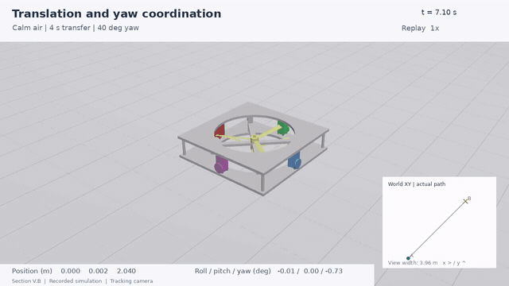
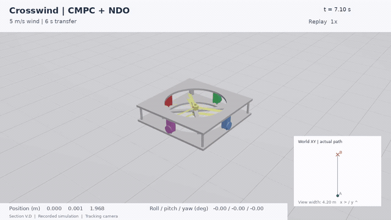
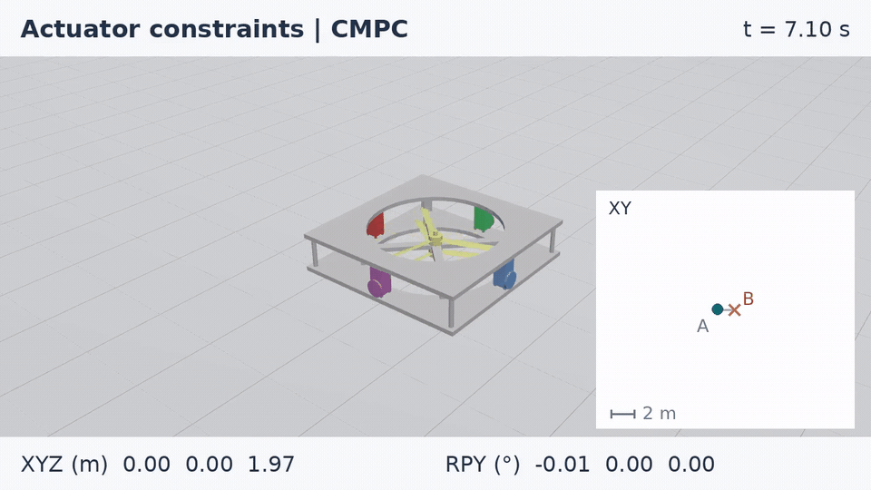
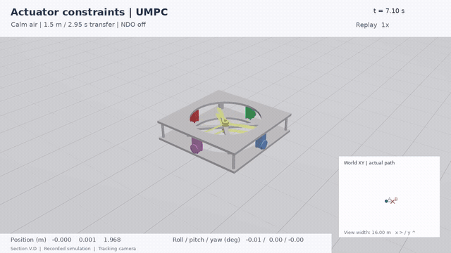
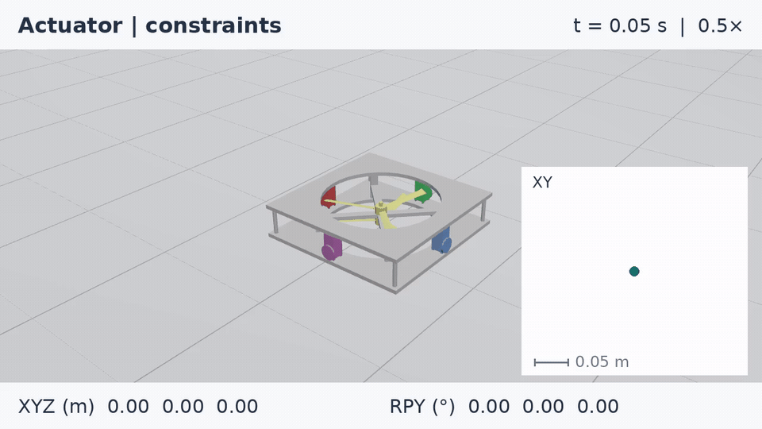
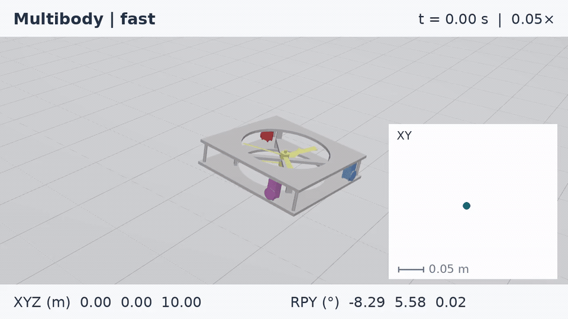

# MMC UAV: Dynamics, Design and Control

ROS 2 and Gazebo Harmonic models, control code and reproducible numerical
experiments accompanying **Dynamic analysis and control of a moving mass
controlled co-axial bi-rotor UAV**.

The repository includes the six-degree-of-freedom dynamics, force-driven moving
mass actuators, constrained MPC, nonlinear disturbance observer, PID/LQR
baselines, design-criterion calculations, and the numeric records supporting the
paper's simulations.

## Build and run

Tested on Ubuntu 22.04, Python 3.10, ROS 2 Humble and Gazebo Harmonic. Start in a
terminal with Humble available and clone this repository into its own workspace.
See [installation details](docs/installation.md) for dependencies and versions.

```bash
source /opt/ros/humble/setup.bash
python3 -m pip install -r requirements.txt
export GZ_VERSION=harmonic
export CMAKE_BUILD_PARALLEL_LEVEL=2
colcon build --executor sequential --cmake-args -DBUILD_TESTING=OFF
source install/setup.bash
python3 scripts/run_experiment.py wind_cmpc_ndo --gui
```

This runs the paper's six-second A→B transfer under 5 m/s crosswind with CMPC
and NDO compensation. Omit `--gui` for headless operation. The repository
contains the Harmonic-compatible bridge and the two custom Gazebo plugins; build
all six packages together.

## Paper experiments

Each profile supplies its physical model, world, task, controller configuration
and ROS parameters. Each invocation starts a fresh ROS/Gazebo partition and saves
its effective configuration and measurements in a new output directory.

```bash
python3 scripts/run_experiment.py --list
python3 scripts/run_experiment.py wind_cmpc_ndo
python3 scripts/run_experiment.py pressure_cmpc
python3 scripts/run_experiment.py scan_omega30
python3 scripts/run_experiment.py coordinated_motion
```

Use `--gui` to display Gazebo, `--output results/my_run` to choose a new output
directory, or `--dry-run` to inspect the command. `--duration 12` explicitly
shortens a run for an installation check. The [experiment guide](docs/experiments/README.md)
explains configurations, windows and repeated runs.

The supplied records can also be analyzed without ROS or Gazebo:

```bash
python3 -m analysis.closed_loop
python3 -m analysis.mechanisms --multibody
```

These commands recompute 100 closed-loop metrics from 25 recorded runs, the
actuator design relations, and the thirteen independent multibody comparisons.
Outputs go to `results/`. See [data and numerical methods](docs/data.md) for the
full-precision records, checksums and metric definitions.

## Repository layout

| Directory | Contents |
|---|---|
| `src/mmc_control` | Dynamics, controllers, experiment factories and ROS launch |
| `src/mmc_gazebo_systems` | Force-servo and measured-wind Gazebo plugins |
| `src/mmc_interfaces` | Wind command/status messages |
| `src/mmc_uav_description` | URDF, CAD meshes and worlds |
| `src/ros_gz_bridge`, `src/ros_gz_interfaces` | Harmonic-compatible ROS/Gazebo bridge |
| `experiments` | Declared configurations and per-experiment physical models |
| `analysis` | Design criteria, coupling calculations, multibody replay and metrics |
| `data` | Numeric records used by the analysis |
| `docs`, `videos` | Instructions, model views and recorded simulation videos |

## MMC UAV model

<p align="center">
  
</p>

## Simulation videos

The videos replay the recorded simulations used in the paper, using the model's
CAD meshes and Gazebo Harmonic's rendering engine. A tracking camera shows the
moving masses and attitude; the XY inset shows the full motion relative to the
target. Closed-loop videos include takeoff, maneuver and holding through 70 s.
The wind examples use recorded run 1; all three runs remain in the numerical
comparison.

| Paper experiment | Full videos |
|---|---|
| V.A — Isolated positioning | [Single mass, paired masses, dual-axis motion and constraints](videos/isolated_actuators.mp4) |
| V.A — Multibody consistency | [All thirteen recorded tests](videos/multibody_checks.mp4) |
| V.B — Translation and yaw | [4 s transfer with 40° yaw](videos/coordinated_motion.mp4) |
| V.C — Mass ratio, fixed total mass | [Low](videos/scan_mu_low.mp4) · [Nominal](videos/scan_nominal.mp4) · [High](videos/scan_mu_high.mp4) |
| V.C — Total mass, fixed mass ratio | [1.39 kg](videos/scan_M_low.mp4) · [1.45 kg](videos/scan_nominal.mp4) · [1.55 kg](videos/scan_M_high.mp4) |
| V.C — Actuator bandwidth | [10 rad/s](videos/scan_omega10.mp4) · [20 rad/s](videos/scan_nominal.mp4) · [30 rad/s](videos/scan_omega30.mp4) |
| V.C — Rotor efficiency | [0.75](videos/efficiency_k75.mp4) · [0.85](videos/efficiency_k85.mp4) · [0.95](videos/efficiency_k95.mp4) |
| V.D — 5 m/s crosswind | [PID](videos/wind_pid.mp4) · [LQR](videos/wind_lqr.mp4) · [CMPC](videos/wind_cmpc.mp4) · [CMPC + NDO](videos/wind_cmpc_ndo.mp4) |
| V.D — Actuator-demanding transfer | [CMPC](videos/pressure_cmpc.mp4) · [UMPC](videos/pressure_umpc.mp4) |

### Recorded motion previews

Click a preview to open the complete MP4. Preview excerpts retain the indicated
playback speed. The [video guide](videos/README.md) provides source records,
chapter times and commands for rendering the videos.

[](videos/coordinated_motion.mp4)

[](videos/wind_cmpc_ndo.mp4)

[](videos/pressure_cmpc.mp4)

[](videos/pressure_umpc.mp4)

[](videos/isolated_actuators.mp4)

[](videos/multibody_checks.mp4)

## License

First-party code and supplied simulation records are distributed under the
[MIT license](LICENSE). The included ROS/Gazebo bridge packages retain their
Apache 2.0 licenses and attribution; see [third-party notices](THIRD_PARTY.md).
