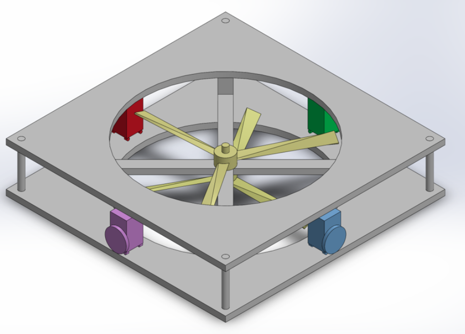
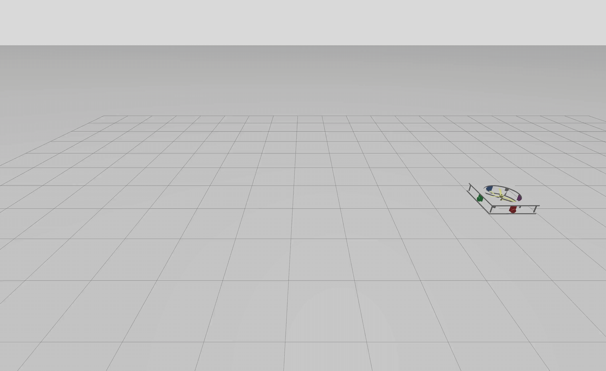
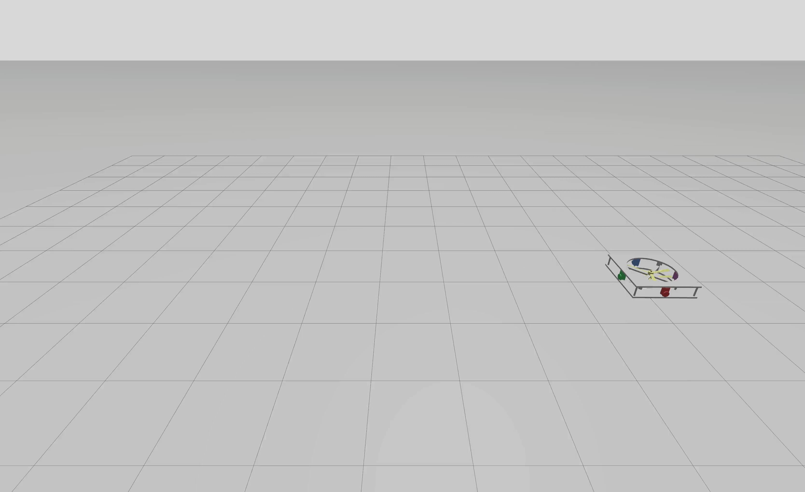

# MMC UAV: Dynamics, Design and Control

ROS 2 and Gazebo Harmonic models, control code and reproducible numerical
experiments accompanying **Dynamic analysis and control of a moving mass
controlled co-axial bi-rotor UAV**.

The repository includes the six-degree-of-freedom dynamics, force-driven moving
mass actuators, constrained MPC, nonlinear disturbance observer, PID/LQR
baselines, design-criterion calculations, and the numeric records supporting the
paper's simulations.

## Build and run

Tested on Ubuntu 22.04, Python 3.10, ROS 2 Humble and Gazebo Harmonic. Start in a
terminal with Humble available and clone this repository into its own workspace.
See [installation details](docs/installation.md) for dependencies and versions.

```bash
source /opt/ros/humble/setup.bash
python3 -m pip install -r requirements.txt
export GZ_VERSION=harmonic
export CMAKE_BUILD_PARALLEL_LEVEL=2
colcon build --executor sequential --cmake-args -DBUILD_TESTING=OFF
source install/setup.bash
ros2 launch mmc_control mmc_launch.py
```

The default GUI demonstration performs an A→B transfer with 3 m/s wind and NDO
compensation. For headless operation, add `enable_gui:=false`. The repository
contains the Harmonic-compatible bridge and the two custom Gazebo plugins; build
all six packages together.

## Paper experiments

Each profile supplies its physical model, world, task, controller configuration
and ROS parameters. Each invocation starts a fresh ROS/Gazebo partition and saves
its effective configuration and measurements in a new output directory.

```bash
python3 scripts/run_experiment.py --list
python3 scripts/run_experiment.py wind_cmpc_ndo
python3 scripts/run_experiment.py pressure_cmpc
python3 scripts/run_experiment.py scan_omega30
python3 scripts/run_experiment.py coordinated_motion
```

Use `--gui` to display Gazebo, `--output results/my_run` to choose a new output
directory, or `--dry-run` to inspect the command. `--duration 12` explicitly
shortens a run for an installation check. The [experiment guide](docs/experiments/README.md)
explains configurations, windows and repeated runs.

The supplied records can also be analyzed without ROS or Gazebo:

```bash
python3 -m analysis.closed_loop
python3 -m analysis.mechanisms --multibody
```

These commands recompute 100 closed-loop metrics from 25 recorded runs, the
actuator design relations, and the thirteen independent multibody comparisons.
Outputs go to `results/`. See [data and numerical methods](docs/data.md) for the
full-precision records, checksums and metric definitions.

## Repository layout

| Directory | Contents |
|---|---|
| `src/mmc_control` | Dynamics, controllers, experiment factories and ROS launch |
| `src/mmc_gazebo_systems` | Force-servo and measured-wind Gazebo plugins |
| `src/mmc_interfaces` | Wind command/status messages |
| `src/mmc_uav_description` | URDF, CAD meshes and worlds |
| `src/ros_gz_bridge`, `src/ros_gz_interfaces` | Harmonic-compatible ROS/Gazebo bridge |
| `experiments` | Declared configurations and per-experiment physical models |
| `analysis` | Design criteria, coupling calculations, multibody replay and metrics |
| `data` | Numeric records used by the analysis |
| `docs`, `videos` | Instructions, model views and demonstration recordings |

## MMC UAV model

<p align="center">
  
</p>

## Demo videos

These videos illustrate the platform and controller. Their demonstration settings
are separate from the paper experiment profiles; the controller benchmark uses
5 m/s wind. Use the profiles and numeric records below for quantitative comparisons.

The GIFs below are converted from the full original video frame and full video
duration without manual cropping or resizing. Click any GIF to open the
corresponding MP4 file in the repository.

### Nominal transfer demonstration

<p align="center">
  <a href="videos/experiment_a_ab_hold.mp4">
    
  </a>
</p>

<p align="center">
  Full video: <a href="videos/experiment_a_ab_hold.mp4">experiment_a_ab_hold.mp4</a>
</p>

### Coordinated translation and yaw demonstration

<p align="center">
  <a href="videos/experiment_b_ab_yaw_step.mp4">
    
  </a>
</p>

<p align="center">
  Full video: <a href="videos/experiment_b_ab_yaw_step.mp4">experiment_b_ab_yaw_step.mp4</a>
</p>

### 3 m/s wind demonstration with NDO

<p align="center">
  <a href="videos/experiment_d_wind_ndo_on.mp4">
    
  </a>
</p>

<p align="center">
  Full video: <a href="videos/experiment_d_wind_ndo_on.mp4">experiment_d_wind_ndo_on.mp4</a>
</p>

The recorded MP4 files are stored under [`videos/`](videos/), and additional
scenario notes live in [`docs/experiments/README.md`](docs/experiments/README.md).


## License

First-party code and supplied simulation records are distributed under the
[MIT license](LICENSE). The included ROS/Gazebo bridge packages retain their
Apache 2.0 licenses and attribution; see [third-party notices](THIRD_PARTY.md).
